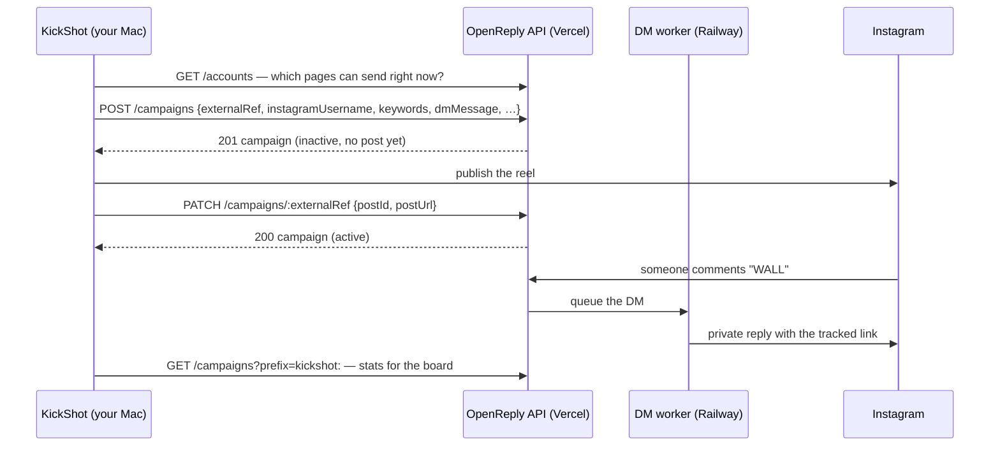

# KickShot Studio → OpenReply

KickShot Studio (the local Node app on your Mac that books and publishes reels
and carousels) gives every reel it books a comment-to-DM campaign here: comment
**WALL** under the reel, get a DM with a tracked link to feetbitsneakers.com,
tap through to WhatsApp. It does that through a small machine-to-machine API on
this same OpenReply instance, the one already running on Vercel and Railway. No
second OpenReply, no second database.

This file covers the whole thing:

1. [How it works](#how-it-works)
2. [Connecting your five Instagram pages](#connecting-your-five-instagram-pages)
3. [Making the token](#making-the-token)
4. [The API contract](#the-api-contract), with curl examples
5. [Limits](#limits): 750 private replies an hour, rate limits, what never fires
6. [Sign-in codes are never answered](#sign-in-codes-are-never-answered)
7. [Deploying it](#deploying-it): the steps that need your OK
8. [Checklist](#checklist)

---

## How it works



- **A campaign is born switched off.** It exists before the reel does, so
  KickShot can catch a bad DM or an unconnected page *before* publishing. It
  cannot fire: the worker only matches active campaigns bound to the post that
  was commented on.
- **Attaching the post switches it on.** After the reel is live, KickShot sends
  its media id. If the publish failed, nothing is attached and nothing fires.
- **`externalRef` is KickShot's name for the campaign**, e.g.
  `kickshot:<run>:<page>`. Creating twice with the same ref returns the same
  campaign, so a retry after a timeout never makes a second campaign that sends
  a second DM.
- **Every campaign is an ordinary OpenReply campaign.** It shows up in
  `/campaigns`, the DM log, the dashboard and the WhatsApp funnel like a
  hand-built one, because the API runs the dashboard's own validation,
  tracked-link and report code (`lib/automations/campaign.ts`).

---

## Connecting your five Instagram pages

The pages: **@feetbitgroup**, **@feetbit.sneakers**, **@legitsneakers.ug**,
**@flashkidstore** and **@socksy.shopping**. Each one is connected once, by
you, in the dashboard. KickShot cannot connect a page, and neither can this
API: it is a Meta OAuth login that only the page's owner can approve.

### Before you start, for each page

- It is a **Professional account** (Business or Creator) linked to a Facebook
  Page. A personal account cannot receive the messaging permission.
- It has a **role on the Meta app** and has **accepted the invite**. The app
  holds Standard Access, which only covers accounts with a role. Without it the
  login succeeds and every later call fails with `Unsupported request - method
  type: get`. Invite the username under *App roles → Roles → Instagram
  testers*, then accept it inside Instagram as that page: *Settings and
  activity → Apps and websites → Tester invites*. Full story in
  [setup.md](setup.md#publishing-is-not-advanced-access-every-account-still-needs-a-role-on-the-app).

### Connecting one page

1. In a browser, sign in to **instagram.com as that page**. The login uses
   whichever Instagram account the browser is signed in to, so switch accounts
   (or use a private window) before each page — otherwise you reconnect the
   same page five times.
2. Open the OpenReply dashboard and press **Connect Instagram** in the top bar.
3. Approve the four permissions Instagram asks for.
4. You land back on the dashboard with `?connected=true`. Open
   **Account health** (`/overview`) and check the page shows a valid token and
   **Webhook ready**. "Webhook pending" means Meta is not delivering that
   page's comments yet, and campaigns on it cannot fire.

Repeat for each page, signing in to instagram.com as the next one first. If a
page says `already_connected`, it is connected to a different OpenReply
workspace; disconnect it there first.

### Checking what KickShot can see

Once the token is set up ([below](#making-the-token)):

```bash
curl -s https://openreply-azure-six.vercel.app/api/service/v1/accounts \
  -H "Authorization: Bearer $OPENREPLY_SERVICE_TOKEN"
```

```json
{
  "accounts": [
    {
      "id": "cm3…",
      "username": "feetbit.sneakers",
      "connected": true,
      "tokenExpiresAt": "2027-01-24T05:00:00.000Z",
      "canPrivateReply": true,
      "webhookSubscribed": true,
      "privateReplyLimitPerHour": 750,
      "privateRepliesUsedThisHour": 12,
      "privateRepliesRemainingThisHour": 738
    }
  ]
}
```

A page that is missing from the list is not connected. `connected: false`
means its token expired (a password change kills every token too): reconnect
it. `canPrivateReply: false` with `connected: true` means either the webhook is
not subscribed or the page has used its 750 replies this hour.

Tokens last about 60 days and the daily `refresh-tokens` cron renews them.
`tokenExpiresAt` lets KickShot warn you before one lapses.

---

## Making the token

One token, held by KickShot. OpenReply stores only its SHA-256, so the token
cannot be recovered from Vercel's env or a database backup — if it is lost,
make a new one.

```bash
# 1. Make the token. This is what KickShot keeps (its .env, gitignored).
openssl rand -hex 32
```

```bash
# 2. Hash it. This is what OpenReply keeps. Paste the token in place of <token>.
printf '%s' '<token>' | shasum -a 256 | cut -d' ' -f1
```

`printf '%s'` matters: `echo` adds a newline, which changes the hash, and every
request then fails with 401.

```bash
# 3. Find the workspace id the token may act in (your FeetBit workspace).
#    Read-only. Run it against the production database URL yourself.
psql "$DATABASE_URL" -c 'select id, name from "Workspace";'
```

Then:

| Where | Variable | Value |
|---|---|---|
| Vercel (Production) | `OPENREPLY_SERVICE_TOKEN_SHA256` | the 64-hex hash from step 2 |
| Vercel (Production) | `OPENREPLY_SERVICE_WORKSPACE_ID` | the workspace id from step 3 |
| Vercel (optional) | `OPENREPLY_SERVICE_RATE_LIMIT_PER_MINUTE` | default `120` |
| KickShot `.env` | `OPENREPLY_SERVICE_TOKEN` | the token from step 1 |
| KickShot `.env` | `OPENREPLY_BASE_URL` | `https://openreply-azure-six.vercel.app` |

The Railway worker needs none of these: it never serves the API.

**Rotating:** make a new token, put its hash in Vercel, redeploy, update
KickShot. The old token stops working at the redeploy.
**Switching it off:** delete `OPENREPLY_SERVICE_TOKEN_SHA256` and redeploy.
Every route then answers `503 {"error":"service API not configured"}`.

---

## The API contract

Base URL: `https://openreply-azure-six.vercel.app/api/service/v1`
Every request: `Authorization: Bearer <token>`. JSON in, JSON out, never cached.

### Auth and errors

| Status | When | Body |
|---|---|---|
| `503` | No token configured, or the workspace id names no workspace | `{"error":"service API not configured"}` |
| `401` | No `Authorization: Bearer …` header, or the wrong token | `{"error":"missing bearer token"}` / `{"error":"invalid token"}` |
| `429` | Over the rate limit (default 120/min per caller IP) | `{"error":"rate limited","retryAfterSeconds":N}` + `Retry-After` |
| `400` | Body is not JSON, or fails validation | `{"error":"invalid input","code":"INVALID_INPUT","issues":[{"path":"keywords","message":"…"}]}` |
| `404` | No campaign with that `externalRef` | `{"error":"…","code":"NOT_FOUND"}` |
| `409` | `externalRef` already used for a campaign on a different page | `{"error":"…","code":"EXTERNAL_REF_CONFLICT"}` |
| `422` | Page unknown / not connected, or activating without a post | `{"error":"…","code":"UNKNOWN_ACCOUNT" \| "ACCOUNT_NOT_CONNECTED" \| "POST_REQUIRED"}` |

The dashboard's login cookie is never accepted here, and this token is never
accepted by the dashboard's routes. The two auth paths share no code.

### `GET /accounts`

Every Instagram account in the workspace and whether it can send right now.
Shape shown [above](#checking-what-kickshot-can-see). Contract fields: `id`,
`username`, `connected`, `tokenExpiresAt` (ISO or `null`), `canPrivateReply`.
Extra fields: `webhookSubscribed`, `privateReplyLimitPerHour`,
`privateRepliesUsedThisHour`, `privateRepliesRemainingThisHour` (the last two
are `null` when Redis cannot be read; `canPrivateReply` then ignores the hourly
count).

### `POST /campaigns`

Create, or update the existing campaign with the same `externalRef`.

| Field | Type | Notes |
|---|---|---|
| `externalRef` | string, **required** | ≤120 chars, letters, digits and `. _ : @ + = ~ -`. Unique per workspace. Use `kickshot:<run>:<page>`. |
| `instagramUsername` | string, **required** | With or without `@`, any case. Must be a connected page. |
| `name` | string, **required** | ≤100. Shown in `/campaigns`. |
| `keywords` | string[], **required** | 1–10, each ≤50. Whole-word, case-insensitive. |
| `dmMessage` | string, **required** | ≤1000. `{username}` is replaced with the commenter's name ("there" when unknown). |
| `linkButtonLabel` | string | ≤20. The tracked link's button title. |
| `trackedDestinationUrl` | URL or `""` | Wrapped in a tracked `/r/<slug>` link. `""` = no link. |
| `secondaryDestinationUrl` | URL or `""` | A second button, e.g. a `wa.me` handoff. |
| `secondaryButtonLabel` | string | ≤20. The second button's title (default "Open link"). |
| `publicReplyEnabled` | boolean | Also reply publicly under the comment. |
| `publicReplyMessages` | string[] | ≤10 variations, one picked per reply. |
| `requireFollow` | boolean | Ask non-followers to follow before revealing the link. |
| `dmTriggerEnabled` | boolean | Also fire when someone DMs the keyword. |
| `followUpEnabled` | boolean | Send a second message after the link. |
| `followUpMessage` | string | ≤1000. |
| `followUpDelayMinutes` | integer | 0–1440. |
| `postId` | string | Instagram media id. Normally sent later by `PATCH`. |
| `postUrl` | URL | The reel's permalink. |
| `isActive` | boolean | Default **`false`**. `true` is refused (`422 POST_REQUIRED`) without a `postId`. |

- **New ref → `201`** `{"campaign": {…}, "created": true}`
- **Existing ref → `200`** `{"campaign": {…}, "created": false}`. Only the
  fields you send change. Omitting `isActive` never switches a live campaign
  off. The tracked link keeps its slug when its destination changes, so links
  already sent keep working.
- **Concurrent creates of one ref** produce one campaign: the losers update it
  and get `200`.

```bash
curl -s -X POST "$OPENREPLY_BASE_URL/api/service/v1/campaigns" \
  -H "Authorization: Bearer $OPENREPLY_SERVICE_TOKEN" \
  -H "Content-Type: application/json" \
  -d '{
    "externalRef": "kickshot:2026-11-25-wall:feetbit.sneakers",
    "instagramUsername": "feetbit.sneakers",
    "name": "Wall reel — feetbit.sneakers",
    "keywords": ["WALL"],
    "dmMessage": "Here you go {username}! The full wall is on the site 👇",
    "linkButtonLabel": "Shop the wall",
    "trackedDestinationUrl": "https://feetbitsneakers.com/collections/wall",
    "publicReplyEnabled": true,
    "publicReplyMessages": ["Sent! Check your DMs 📩", "In your DMs now 🔥"]
  }'
```

### The campaign object

Returned by every campaign route.

```json
{
  "campaign": {
    "externalRef": "kickshot:2026-11-25-wall:feetbit.sneakers",
    "id": "cm3…",
    "name": "Wall reel — feetbit.sneakers",
    "instagramAccountId": "cm2…",
    "instagramUsername": "feetbit.sneakers",
    "keywords": ["WALL"],
    "dmMessage": "Here you go {username}! The full wall is on the site 👇",
    "linkButtonLabel": "Shop the wall",
    "trackedDestinationUrl": "https://feetbitsneakers.com/collections/wall",
    "trackedUrl": "https://openreply-azure-six.vercel.app/r/Xk3_9aQ",
    "secondaryDestinationUrl": null,
    "secondaryButtonLabel": null,
    "secondaryTrackedUrl": null,
    "publicReplyEnabled": true,
    "publicReplyMessages": ["Sent! Check your DMs 📩", "In your DMs now 🔥"],
    "requireFollow": false,
    "dmTriggerEnabled": false,
    "followUpEnabled": false,
    "followUpMessage": null,
    "followUpDelayMinutes": 0,
    "postId": "17900000000000001",
    "postUrl": "https://www.instagram.com/reel/DCx…/",
    "isActive": true,
    "reportUrl": "https://openreply-azure-six.vercel.app/reports/aB9…",
    "createdAt": "2026-11-25T10:00:00.000Z",
    "updatedAt": "2026-11-25T10:20:00.000Z",
    "stats": {
      "dmsSent": 40,
      "dmsSkipped": 5,
      "dmsFailed": 1,
      "linkClicks": 10,
      "ctr": 25,
      "whatsappLeads": 4,
      "lastDmAt": "2026-11-25T12:30:00.000Z"
    }
  }
}
```

Stats: `dmsSkipped` counts every skip — duplicates, rate-limit skips, plan-limit
skips and comments that matched no keyword.
`ctr` is clicks over sends as a percentage, capped at 100 (link-preview bots
and repeat taps can push raw clicks above sends). `whatsappLeads` counts
WhatsApp chats attributed to this campaign through its tracked link.
`lastDmAt` is the last delivered DM, `null` before the first.

### `PATCH /campaigns/:externalRef`

Attach the published reel, pause/resume, or edit. Same fields as `POST` minus
`externalRef` and `instagramUsername` (a campaign never changes page), all
optional. URL-encode the ref if you like; `:` is fine either way.

- **Attach:** `{"postId": "…", "postUrl": "…"}` switches the campaign **on**
  unless you also send `"isActive": false`.
- **Detach:** `{"postId": null}` switches it off.
- **Pause / resume:** `{"isActive": false}` / `{"isActive": true}`. Resuming a
  campaign with no post is `422 POST_REQUIRED`.
- **Edit:** any message field. `followUpEnabled: false` clears the follow-up
  text and delay; `publicReplyEnabled: false` clears the replies; a URL of `""`
  removes that link.

```bash
# After the reel is published: attach it and go live.
curl -s -X PATCH "$OPENREPLY_BASE_URL/api/service/v1/campaigns/kickshot:2026-11-25-wall:feetbit.sneakers" \
  -H "Authorization: Bearer $OPENREPLY_SERVICE_TOKEN" \
  -H "Content-Type: application/json" \
  -d '{"postId": "17900000000000001", "postUrl": "https://www.instagram.com/reel/DCx…/"}'
```

```bash
# Pause it.
curl -s -X PATCH "$OPENREPLY_BASE_URL/api/service/v1/campaigns/kickshot:2026-11-25-wall:feetbit.sneakers" \
  -H "Authorization: Bearer $OPENREPLY_SERVICE_TOKEN" \
  -H "Content-Type: application/json" \
  -d '{"isActive": false}'
```

### `GET /campaigns/:externalRef`

`200 {"campaign": {…}}` with stats, or `404`.

```bash
curl -s "$OPENREPLY_BASE_URL/api/service/v1/campaigns/kickshot:2026-11-25-wall:feetbit.sneakers" \
  -H "Authorization: Bearer $OPENREPLY_SERVICE_TOKEN"
```

### `GET /campaigns`

`200 {"campaigns": [{…}, …]}`, newest first, each with stats. Only campaigns
created through this API; dashboard-built campaigns (no `externalRef`) never
appear.

| Query | Meaning |
|---|---|
| `prefix` | Only refs starting with this, e.g. `kickshot:` or `kickshot:2026-11-25-wall:` |
| `instagramUsername` | Only campaigns on this page |
| `limit` | 1–500, default 100 |

```bash
curl -s "$OPENREPLY_BASE_URL/api/service/v1/campaigns?prefix=kickshot:" \
  -H "Authorization: Bearer $OPENREPLY_SERVICE_TOKEN"
```

There is deliberately no `DELETE`. Pause instead; deleting would throw away the
DM log and stats. Deleting is a dashboard action.

---

## Limits

**750 private replies an hour, per page.** Meta's documented cap for replying
privately to comments on posts and reels. The worker enforces it per account
(`lib/utils/rate-limiter.ts`): over the cap, a DM is requeued for 30 minutes,
up to three times, then logged as `SKIPPED_RATE_LIMIT`. It is per page, so five
pages give five separate allowances. A reel that pulls more than 750 keyword
comments in an hour will see some DMs arrive late or not at all; `GET
/accounts` shows how much of the hour is left. There is no headroom in the
number — if Meta throttles earlier, lower `RATE_LIMIT_MAX`.

**24-hour window.** Instagram only allows a private reply within 24 hours of
the comment. A campaign attached late misses earlier comments past that.

**Keyword overlap.** Two active campaigns on the same reel with the same
keyword both fire. Campaigns on *different* reels never collide, because each
is bound to its own post. Avoid `dmTriggerEnabled` with the same keyword on two
live campaigns on one page: a DM of that word would get both replies.

**API rate limit.** 120 requests a minute per caller, applied before the token
check. KickShot needs a handful per reel.

---

## Sign-in codes are never answered

The WhatsApp number OpenReply replies from is the same OpenWA session that
carries the FeetBit store's sign-in flow. So any message matching "FeetBit
code" — any case, spacing or punctuation, including "FeetBit sign-in / login /
verification / one-time code" — is excluded from every automatic reply, on
every path:

- **WhatsApp inbound:** ignored outright. No auto-reply, and the code is not
  copied into a lead's history.
- **Instagram DM keyword trigger:** skipped, including "match any word"
  campaigns.
- **Instagram comment private reply:** skipped.

And a campaign whose keywords would match it is refused at creation, from the
API, the dashboard and the CSV import alike. The guard is
`lib/safety/sign-in-codes.ts`; the tests are `__tests__/sign-in-codes.test.ts`
and the sign-in block in `__tests__/dm-worker.test.ts`.

---

## Deploying it

Nothing here is live until you approve these steps. In order:

1. **Merge the branch** (`claude/focused-roentgen-528cf4`) into `main` after
   reviewing it.
2. **The migration.** One additive migration,
   `20261125120000_add_automation_external_ref`: a nullable `externalRef`
   column on `Automation` plus a unique index on `(workspaceId, externalRef)`.
   No existing row changes. The Vercel build (`vercel-build`) runs `prisma
   migrate deploy` itself, so deploying applies it. To apply it ahead of the
   deploy instead:
   ```bash
   DATABASE_URL="<production public URL>" npm run db:migrate
   ```
   The old code ignores the new column, so migrating first is safe.
3. **Vercel env vars** (Production): `OPENREPLY_SERVICE_TOKEN_SHA256` and
   `OPENREPLY_SERVICE_WORKSPACE_ID` ([Making the token](#making-the-token)).
   Before they exist, the API answers 503 and nothing else changes.
4. **Deploy Vercel** (the merge to `main` does this).
5. **Redeploy the Railway worker.** The sign-in-code guard for Instagram
   comments and DMs lives in the worker; until it redeploys, only the WhatsApp
   side (which runs on Vercel) is guarded. It needs no new env vars.
6. **Smoke test:** `GET /accounts` with the token → `200` and your pages.
   Without the token → `401`.
7. **Connect the remaining pages** in the dashboard ([above](#connecting-your-five-instagram-pages)).

---

## Checklist

- [ ] Branch reviewed and merged
- [ ] Migration applied (by the Vercel build or by hand)
- [ ] Token made with `openssl rand -hex 32`; hash made with `printf '%s' … | shasum -a 256`
- [ ] `OPENREPLY_SERVICE_TOKEN_SHA256` and `OPENREPLY_SERVICE_WORKSPACE_ID` set on Vercel Production
- [ ] Vercel deployed; Railway worker redeployed
- [ ] `GET /accounts` with the token returns 200; without it, 401
- [ ] Each page has a tester role on the Meta app and accepted the invite
- [ ] @feetbitgroup connected — token valid, webhook ready
- [ ] @feetbit.sneakers connected — token valid, webhook ready
- [ ] @legitsneakers.ug connected — token valid, webhook ready
- [ ] @flashkidstore connected — token valid, webhook ready
- [ ] @socksy.shopping connected — token valid, webhook ready
- [ ] `GET /accounts` shows all five with `canPrivateReply: true`
- [ ] Token and base URL in KickShot's `.env`
- [ ] One test reel: campaign created inactive → reel published → `PATCH` attaches it → a keyword comment from another account gets the DM → `GET` shows `dmsSent: 1`
- [ ] A WhatsApp message "FeetBit code 123456" to the store number gets no auto-reply

## Where the code is

| Piece | File |
|---|---|
| Routes | `app/api/service/v1/accounts`, `…/campaigns`, `…/campaigns/[externalRef]` |
| Token check, 503/401/429 | `lib/service/auth.ts`, `lib/service/rate-limit.ts` |
| Campaign logic for the API | `lib/service/campaigns.ts` |
| Rules shared with the dashboard | `lib/automations/campaign.ts` |
| Sign-in-code guard | `lib/safety/sign-in-codes.ts` |
| Tests (mocked) | `__tests__/service-api.test.ts` |
| Tests (real Postgres) | `__tests__/service-api.db.test.ts` — set `SERVICE_API_TEST_DATABASE_URL` to a local `*_test` database |
