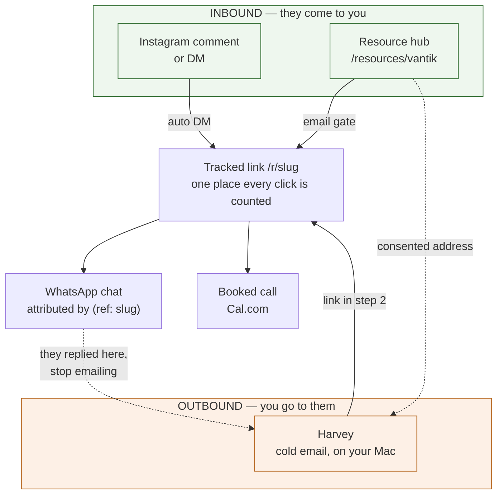

# Operating this stack

What you have, what each piece is for, and how to get results out of it.
[stack.md](stack.md) lists the libraries and hosts; this is the business layer.

---

## The one-sentence version

You have **one database and four ways of getting a conversation started**, and
every one of them ends in the same place: a chat on WhatsApp or a booked call,
attributed back to whatever started it.



The dotted lines are the two that make this a system rather than three separate
tools: a resource download feeds outbound, and a WhatsApp reply stops it.

---

## The four systems

| System | Direction | Where it runs | What it needs from you |
|---|---|---|---|
| **Instagram automation** | Inbound | Vercel + Railway worker, always on | Campaigns with keywords |
| **WhatsApp** | Inbound only | OpenWA container on Railway | A connected number |
| **Resource hub** | Inbound | Vercel, public pages | Resources worth an email |
| **Harvey** | Outbound | **Your Mac** | Approvals, and a sending domain |

Three of the four run without you. Harvey is the one that needs a human in the
loop, by design: nothing it writes is sent until you approve it.

### Why Harvey runs on your Mac and not in the cloud

Its model backend is your logged-in Claude CLI, not a metered API key. That is
the whole reason it costs nothing per email. A cloud container cannot hold that
login, so Harvey lives where the login lives, and this app is its control panel.

Traffic only goes one way: **Harvey calls out, nothing calls in.** No port to
forward, no tunnel, nothing exposed on your network.

---

## Pairing a Harvey

One agent per brand. They have different senders, different offers and different
handoffs, so they are different agents even though one person reviews both.

### First time

1. **Outreach → Pair another Harvey.** Type a short name: `feetbit-wholesale`,
   `vantik`. Lower-case, dashes, no spaces.
2. You get two lines, **shown once**:
   ```
   OPENREPLY_AGENT_ID=...
   OPENREPLY_AGENT_SECRET=...
   ```
   Paste them into that brand's Harvey `.env`. Not retrievable afterwards.
3. In the same Harvey's `harvey.yaml`:
   ```yaml
   openreply:
     enabled: true
     base_url: "https://openreply-azure-six.vercel.app"
     link_destination: "whatsapp"   # or "default" for a booking page
   channels:
     email:
       require_approval: true       # required; Harvey refuses the bridge without it
   ```
4. Set the agent's handoff in Outreach: a WhatsApp number, or a booking URL.
   **This lives here, not in Harvey's config**, so a stolen agent secret cannot
   repoint a link on your own domain at a number you never chose.
5. `harvey run` on the Mac. Within a minute Outreach shows it online.

### A second brand

Clone the checkout so each has its own database, mailbox and config:

```bash
git clone ~/Projects/harvey ~/Projects/harvey-vantik
cd ~/Projects/harvey-vantik && git checkout feat/openreply-bridge
python3.12 -m venv .venv && ./.venv/bin/pip install -e '.[dev]'
```

Then pair a second agent under a new name and repeat. Two `harvey run`
processes, two secrets, one dashboard.

### Rotating a secret

Pair again with the **same name**. A fresh secret is issued and the old one
stops working immediately. That is also the recovery path if a secret leaks.

### Revoking

Set the agent to revoked in Outreach. Its secret stops working at once and
every prospect, email and attribution it produced is kept.

---

## How to actually use it, day to day

### Morning, two minutes, on your phone
Open **Outreach**. If anything is waiting, read it and tap Approve or Don't
send. That is the entire daily obligation. Nothing goes out otherwise.

### Weekly
- **Outreach → Resources**: is there something worth giving away? Each resource
  is a standing lead magnet; one link in a bio covers all of them.
- **WhatsApp**: the chats that started from links, and which campaign each came
  from.
- **Diagnostics**: anything red. This is where a dead Instagram token or an
  agent that stopped checking in shows up.

### Reading the numbers honestly
- **Dashboard** counts Instagram only. Cold-email clicks are deliberately
  excluded so the two channels never flatter each other.
- **Outreach** counts the outbound side: waiting, with Harvey, sent.
- **WhatsApp funnel** is the one that matters most, because it counts
  conversations, not impressions.

---

## What each page is for

| Page | Use it when |
|---|---|
| Dashboard | A quick read on Instagram volume |
| Overview | Per-account Instagram health |
| Inbox | Instagram conversations |
| Campaigns | Create or edit a comment-to-DM campaign |
| DM Logs | "Did that person actually get the DM?" |
| WhatsApp | Chats started from links, per campaign |
| **Outreach** | Approve cold email; pair and configure agents |
| **Resources** | Add and publish lead magnets; see who downloaded |
| Settings | Connect Instagram and WhatsApp numbers |
| Diagnostics | Something is wrong and you want the reason |

---

## Benefits of this shape

**One attribution spine.** Every channel hands out the same kind of tracked
link, so a WhatsApp chat can be traced to the post, the campaign, or the exact
cold email that caused it. Most stacks cannot answer that question at all.

**No per-message AI cost.** Harvey thinks on your existing Claude subscription.
The marginal cost of one more prospect is the cost of discovering them, which
on the free OpenStreetMap provider is zero.

**Nothing sends itself.** Every outbound email waits for a human. The failure
mode of an autonomous sales agent is sending something embarrassing to a real
buyer; here that cannot happen without you tapping a button.

**Consent is structural, not a policy document.** A lead reaches outbound only
if they ticked a box, the email we sent them was accepted, and they have not
been exported before. It is a database query, not a promise.

**It degrades quietly.** The Mac being asleep delays approvals; it does not
lose them. A failed mail send still shows the visitor their link. A dead
Instagram token is named in Diagnostics rather than failing silently.

## Limitations, honestly

**Harvey only runs when your Mac is on.** Approvals queue and apply when it
wakes, but they expire after three days, deliberately: a Monday approval should
not fire on Thursday. If outbound matters, the Mac needs to stay awake
(`caffeinate -s`, or Energy Saver set to never sleep on mains power).

**Deliverability is the real constraint, not the software.** Without a
dedicated sending domain with SPF, DKIM and DMARC, volume above a trickle will
land in spam and can damage your main domain. This is the single biggest thing
standing between the stack and results.

**No cold Instagram DMs, ever.** The Graph API only permits replies inside a
limited window. There is no API that sends a cold IG DM, and anything claiming
otherwise is a ban waiting to happen.

**WhatsApp is inbound only.** Messaging strangers from an unofficial gateway is
the fastest way to lose the number. The prospect always opens the chat by
tapping your link.

**Instagram tokens die when you change a password.** Meta invalidates every
token. Diagnostics names the account; you reconnect it in Settings.

**One Postgres, no preview environment.** Branch previews on Vercel cannot
build, because every env var is Production-scoped. Changes are verified by
tests and merged to deploy. A second database would fix it.

**Bounces are not yet wired.** An address the provider accepts but the
recipient's server later rejects still counts as delivered here. Harvey's own
bounce handling catches it downstream and pauses sending, but later than it
could.

**The resource gate is soft.** A Drive link that someone forwards still works.
That is true of every email wall on the web; the gate buys you the address, not
exclusivity.

---

## If something looks wrong

| Symptom | Where to look |
|---|---|
| "Harvey hasn't checked in" | Is the Mac awake, is `harvey run` running |
| Agent never checks in at all | Diagnostics names the reason: `bad_signature` (wrong secret), `stale_timestamp` (clock off by >5 min), `AGENT_REVOKED` |
| No DMs going out | Diagnostics → accounts needing reconnect |
| Resource email not arriving | The lead row records the delivery error; check Diagnostics |
| `node_modules` vanished again | `cleanup-disk.sh` swept it. `openreply` and `harvey` are in its protected list now |
